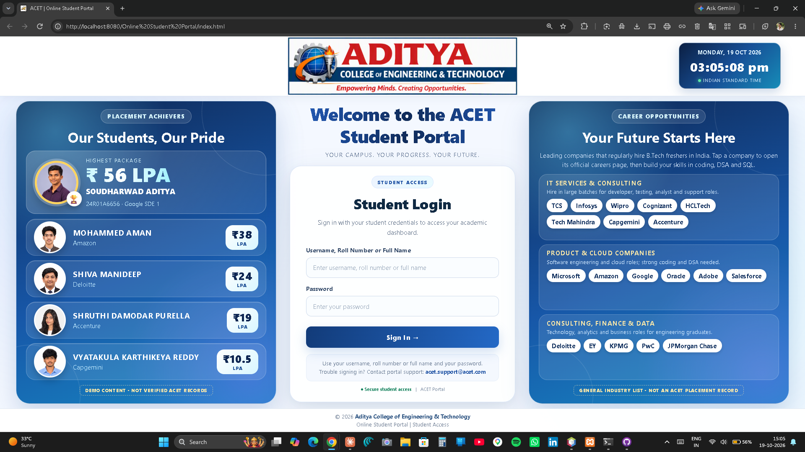
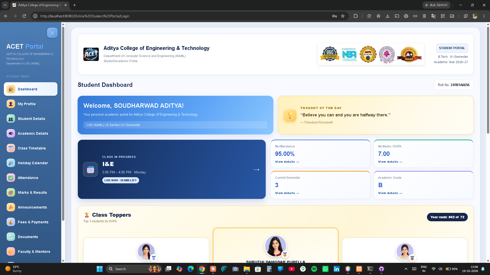
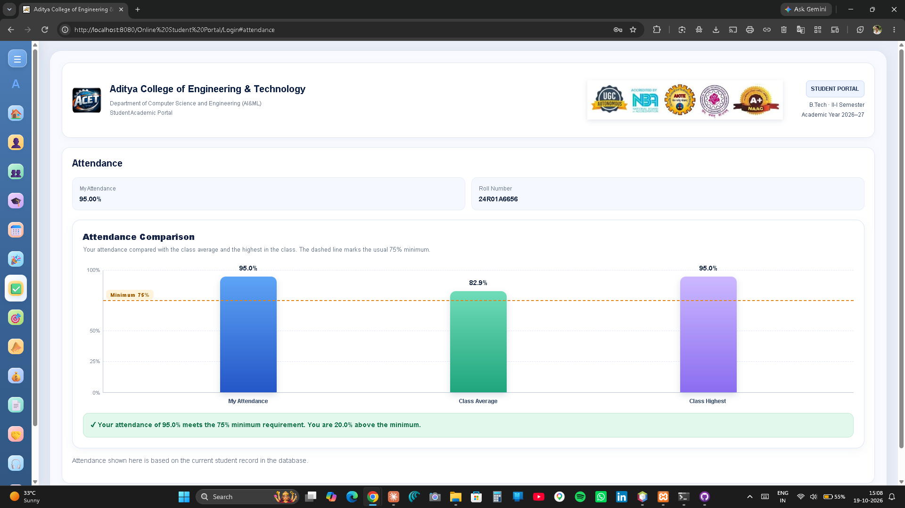
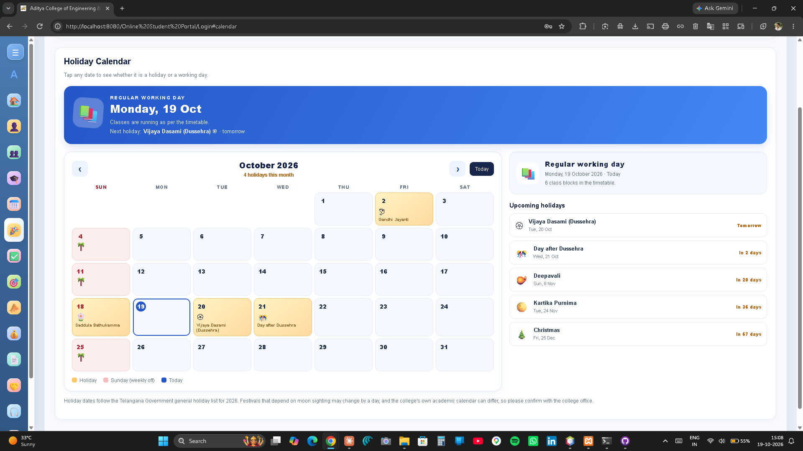
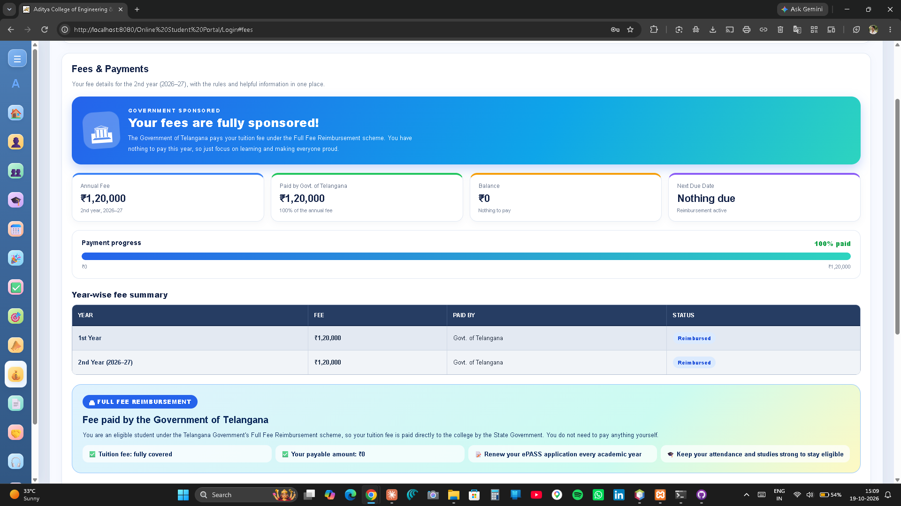
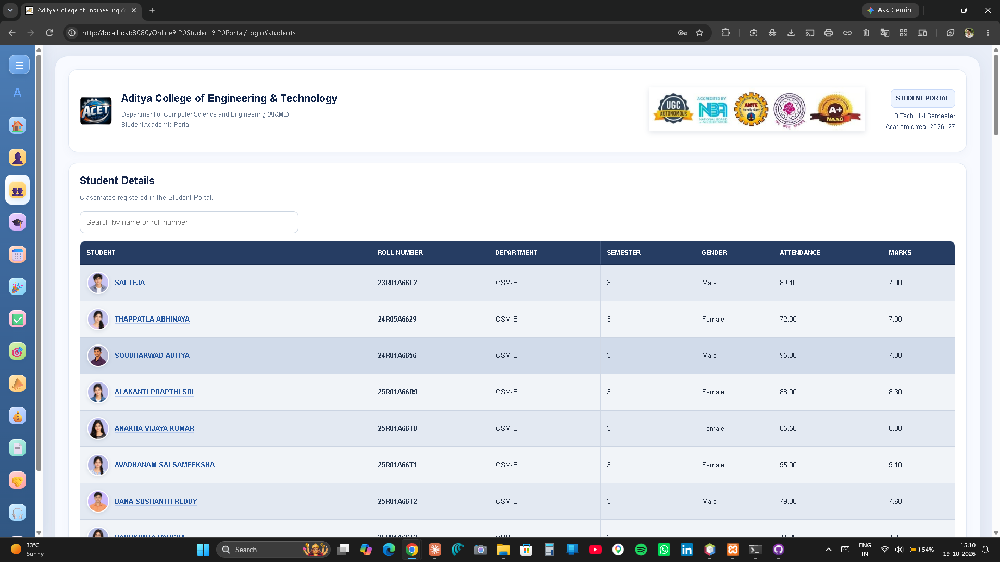

# Online Student Portal

A web-based student portal built with **Java Servlets, JDBC and MySQL**. Students sign in and see their own dashboard with profile, attendance, marks, timetable, fees, holiday calendar and more.

> Micro project for **Object-Oriented Programming through Java**, II B.Tech I Semester, Department of CSE (AI&ML), CMR Institute of Technology (2026–27).

---

## Features

**Sign in and security**
- Sign in with **username, roll number or full name** (any capital or small letters) and password
- Session-based access, with logout
- No-cache headers, so the Back button cannot reopen the dashboard after logout
- All database queries use `PreparedStatement` (protects against SQL injection)
- All displayed data is HTML-escaped
- Change Password with current-password check, minimum length and confirmation

**Dashboard**
- Welcome card, thought of the day and a live **upcoming class** card
- Clickable stat cards for attendance, marks / SGPA, semester and grade
- **Class Toppers** podium (top 3 by SGPA) and the student's own rank
- Quick Access cards for every section
- Remembers the scroll position when you press Back, and keeps you on the same page after refresh

**Sections**
- **My Profile** with a photo
- **Student Details** with live search and a popup profile when a name is clicked
- **Academic Details**
- **Class Timetable** with labs, breaks and lunch highlighted
- **Holiday Calendar** (Telangana 2026 holiday list) with a month view, holiday banner, countdown and upcoming holidays
- **Attendance** and **Marks & Results**, each with a bar chart against the class average and highest
- **Fees & Payments** (sample data): status banner, progress bar, installments, rules, how to pay and fee reimbursement information
- **Documents**: unofficial sample marks memo and bonafide certificate (printable)
- **Faculty & Mentors** with email links
- **Help & Support** with contact details and FAQs
- **Change Password**

**Design**
- Responsive layout for desktop, tablet and phone
- Animated gradient headings, a live IST clock, a collapsible sidebar and a reduced-motion option

---

## Technologies

| Layer | Technology |
|---|---|
| Interface | HTML5, CSS3, JavaScript |
| Server side | Java Servlets (`javax.servlet`), `@WebServlet("/Login")` |
| Database access | JDBC with MySQL Connector/J |
| Database | MySQL |
| Server | Apache Tomcat 9 (or lower, because the code uses `javax.servlet`) |
| IDE | Apache NetBeans (Ant web project) |

---

## Project structure

```
Online Student Portal
├── src/java/portal/Login.java     Servlet: login, dashboard, documents, password change
├── web/
│   ├── index.html                 Login page
│   ├── META-INF/context.xml
│   └── images/                    Logo, banner, student photos and avatars
├── nbproject/                     NetBeans project settings
├── build.xml
└── README.md
```

---

## How to run it

### 1. Install
- JDK 8 or newer
- Apache NetBeans
- Apache Tomcat 9
- MySQL (for example MySQL Server or XAMPP)
- MySQL Connector/J (the MySQL JDBC driver `.jar`)

### 2. Create the database
Run this in MySQL (phpMyAdmin or MySQL Workbench):

```sql
CREATE DATABASE student_portal;
USE student_portal;

CREATE TABLE students (
    id          INT(11)       NOT NULL AUTO_INCREMENT,
    username    VARCHAR(50)   NOT NULL,
    password    VARCHAR(255)  NOT NULL,
    full_name   VARCHAR(100)  NOT NULL,
    roll_number VARCHAR(20)   NOT NULL,
    department  VARCHAR(100)  DEFAULT NULL,
    semester    INT(11)       DEFAULT NULL,
    email       VARCHAR(100)  DEFAULT NULL,
    attendance  DECIMAL(5,2)  DEFAULT 0.00,
    marks       DECIMAL(4,2)  DEFAULT 0.00,
    grade       VARCHAR(5)    DEFAULT 'N/A',
    achievement VARCHAR(255)  DEFAULT 'No achievement yet',
    gender      VARCHAR(10)   DEFAULT NULL,
    PRIMARY KEY (id),
    UNIQUE KEY username (username),
    UNIQUE KEY roll_number (roll_number)
);

-- Sample students (fake data for testing)
INSERT INTO students
(username, password, full_name, roll_number, department, semester,
 email, attendance, marks, grade, achievement, gender)
VALUES
('25R00A0001', '123123', 'SAMPLE STUDENT ONE',   '25R00A0001', 'CSM-E', 3, 'one@example.com',   92.00, 8.70, 'A', 'No achievement yet', 'Male'),
('25R00A0002', '123123', 'SAMPLE STUDENT TWO',   '25R00A0002', 'CSM-E', 3, 'two@example.com',   81.50, 7.90, 'B', 'No achievement yet', 'Female'),
('25R00A0003', '123123', 'SAMPLE STUDENT THREE', '25R00A0003', 'CSM-E', 3, 'three@example.com', 68.00, 6.40, 'C', 'No achievement yet', 'Female'),
('25R00A0004', '123123', 'SAMPLE STUDENT FOUR',  '25R00A0004', 'CSM-E', 3, 'four@example.com',  88.40, 9.10, 'A', 'No achievement yet', 'Male');
```

### 3. Get the code
```
git clone https://github.com/saditya56/Online-Student-Portal.git
```

### 4. Open it in NetBeans
1. **File → Open Project** and choose the project folder.
2. Right-click the project, choose **Properties → Libraries → Add JAR/Folder**, and add the MySQL Connector/J `.jar`.
3. Make sure Tomcat 9 is added under **Tools → Servers**.

### 5. Check the database settings
In `src/java/portal/Login.java`, change these if your MySQL setup is different:

```java
private static final String DB_URL      = "jdbc:mysql://localhost:3306/student_portal";
private static final String DB_USER     = "root";
private static final String DB_PASSWORD = "";
```

Also change `SUPPORT_EMAIL` and `SUPPORT_HOURS` to your real support details.

### 6. Run
Right-click the project and choose **Clean and Build**, then **Run**. Sign in with a sample student, for example `25R00A0001` and password `123123`.

### Photos
Student photos use `boy1.jpg` to `boy10.jpg` and `girl1.jpg` to `girl10.jpg` in `web/images/`. Each student gets one by gender. A few roll numbers have a fixed photo set in the `photoFor()` method in `Login.java`.

---

## Screenshots

Add your screenshots in a `screenshots` folder and keep the names below, or edit the lines.

| Login | Dashboard |
|---|---|
|  |  |

| Attendance chart | Holiday calendar |
|---|---|
|  |  |

| Fees & Payments | Student details |
|---|---|
|  |  |

---

## Known limitations

This is a learning project, not a production system.

- Passwords are stored as **plain text**. They should be hashed (for example with BCrypt).
- The database user is `root` with an empty password. A real system needs a limited-rights user.
- Student Details shows every student's attendance and marks to all logged-in students.
- The timetable, faculty list and placement banners are fixed in the code.
- Fees, due dates and the support contact are **sample data**.
- Announcements and online payment are placeholders.
- The sample marks memo and bonafide certificate are **unofficial**.
- The dashboard HTML is built with `out.println()`. JSP or a template engine would be easier to maintain.
- A new database connection is opened for each request, with no connection pool.

## Future improvements

- Password hashing and a dedicated database user
- Student registration and an admin module
- Role-based access (student, faculty, admin)
- Database-driven timetable, announcements, fees and holidays
- JSP or a template engine, plus a connection pool
- HTTPS and a limit on failed login attempts

---

## Team

| Name | Roll number |
|---|---|
| Janke Shashivardhan Reddy | 25R01A66V8 |
| Karre Sricharan | 25R01A66W4 |
| Kunchapu Prashanth | 25R01A66W7 |
| Mettukadi Akash | 25R01A66X2 |
| Shiva Manideep | 25R01A66Y2 |
| Thoutam Abhiram | 25R01A66Y8 |
| Vatyakula Karthikeya Reddy | 25R01A66Y9 |
| Soudharwad Aditya | 24R01A6656 |

**Guide:** Mr. P. Niranjan Reddy, Assistant Professor, Department of CSE (AI&ML)

---

## Notes

- This project is for **academic use**. Student names, marks, fees and placement details shown in the demo are sample data, not official college records.
- Holiday dates follow the Telangana Government general holiday list for 2026. Please confirm with the college.
